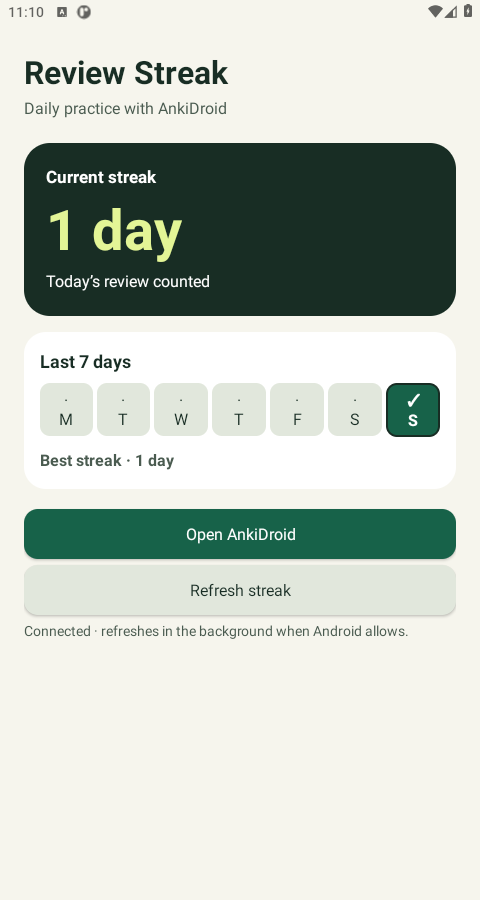

# Review Streak

Review Streak is an Android companion for AnkiDroid. Answer a flashcard in AnkiDroid and Review Streak records that day. The dashboard shows your current streak, best recorded streak, and the last seven days.

## Install and connect

1. Install [AnkiDroid](https://github.com/ankidroid/Anki-Android/releases/latest) and finish its first-run setup. Review Streak is built for Android 8.0 and newer and targets the standard AnkiDroid app. AnkiDroid 2.25.3 is the compatibility baseline.
2. Download `Review-Streak.apk` from [Releases](https://github.com/zahediparsa/anki-review-streak/releases/latest) and open it on your phone. Android may ask you to allow installs from the browser or file manager you used.
3. Open **Review Streak**, tap **Connect AnkiDroid**, and grant the Android permission. You can then tap **Open AnkiDroid** to study.
4. Answer at least one card. The streak refreshes when you return to Review Streak. Android also schedules background checks roughly every 15 minutes when conditions allow. **Refresh streak** runs a check on demand.

## What counts

- A day counts once after AnkiDroid records an answer, even if you stop before finishing the deck. Opening a deck or revealing an answer alone earns no credit. Answers across all decks count.
- Days follow the phone’s local calendar. A streak through yesterday stays active throughout today. If you skip today, it resets tomorrow.
- The public AnkiDroid API exposes only the latest timestamp for each card. Review Streak checks cards rated in the last 31 Anki scheduling days and saves the calendar dates it discovers. If you check after the same card was reviewed on several days, earlier dates may be missing from the initial or recovered history. The best streak is based on recorded dates. Synced reviews can also count if AnkiDroid exposes their timestamps.
- Review Streak requests AnkiDroid’s shared database permission and only queries the last-review timestamp field. It saves dates on your device and has no Internet permission. Clearing its app data or uninstalling it clears the dates it has saved.

## Build

The app uses Java and the Android SDK. Python drives the build so it can run without Gradle, Android Studio, or third-party libraries.

Prerequisites are Python 3.9+, JDK 17+, Android SDK Platform 35 and Build Tools 35.0.0. Set `JAVA_HOME` and `ANDROID_HOME` if needed.

```sh
sdkmanager "platforms;android-35" "build-tools;35.0.0"
python tools/build.py
javac -d build/test-classes app/src/main/java/io/github/zahediparsa/reviewstreak/Streak.java tests/StreakTest.java
java -cp build/test-classes io.github.zahediparsa.reviewstreak.StreakTest
```

The build verifies its APK signature and outputs `build/Review-Streak.apk`. A local development key is generated automatically. For release signing, set `REVIEW_STREAK_KEY_PASSWORD` and pass `--keystore /path/to/key.p12 --alias review-streak`. Use the same release key for every update.

The app reads AnkiDroid through its [public card provider](https://github.com/ankidroid/Anki-Android/blob/v2.25.3/api/src/main/java/com/ichi2/anki/FlashCardsContract.kt).

## Verification

See the [emulator test results](docs/testing.md) for the checks performed with the official AnkiDroid APK.


